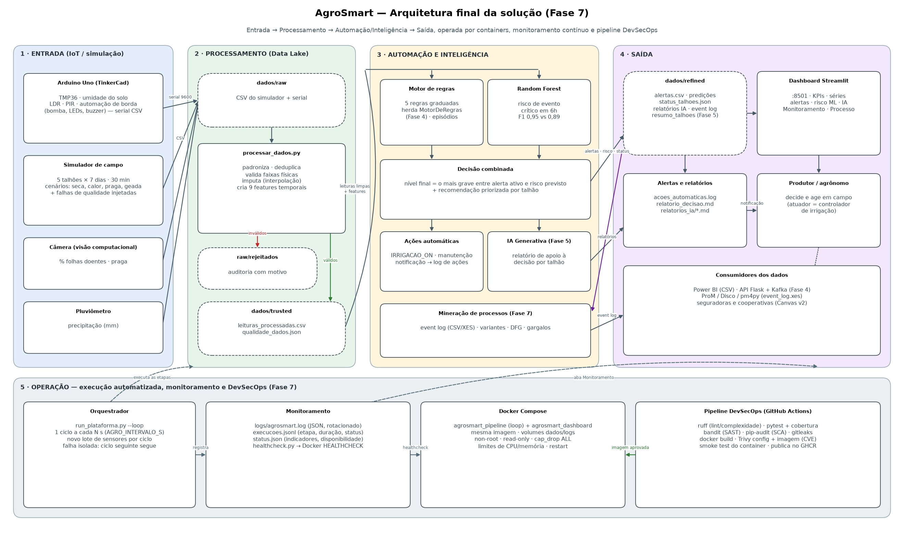
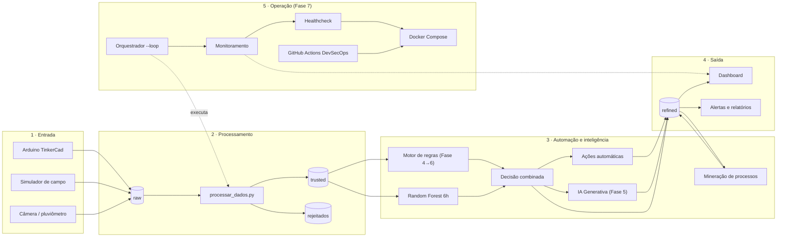

# 1. Arquitetura final da solução (15%)

A arquitetura final consolida tudo o que o AgroSmart construiu desde a Fase 4 em uma plataforma única,
**operada como produto**: roda em containers, executa sozinha em ciclos, se auto-monitora e só chega ao
ambiente depois de passar por um pipeline de qualidade e segurança.



> Imagem gerada por `python docs/fase7/gerar_diagramas.py`. Versão em texto (Mermaid) no fim deste documento.

## 1.1 Componentes do sistema

| # | Camada | Componente | Arquivo(s) | Responsabilidade | Fase de origem |
|---|---|---|---|---|---|
| 1 | Entrada | Estação Arduino (TinkerCad) | `iot/agrosmart_tinkercad.ino`, `iot/circuito.md` | TMP36, umidade do solo, LDR, PIR; automação de borda (bomba com histerese, LEDs, buzzer); envia CSV pela serial | 6 |
| 2 | Entrada | Simulador de campo | `iot/simulador_sensores.py` | 5 talhões × 7 dias, leitura a cada 30 min, com cenários (seca, calor, praga, geada) e falhas de qualidade injetadas | 6 |
| 3 | Entrada | Câmera e pluviômetro (simulados) | idem | % de folhas doentes, praga detectada, precipitação | 5/6 |
| 4 | Processamento | Data Lake em camadas | `dados/raw` → `dados/trusted` → `dados/refined` | Organização dos dados por grau de confiança, com rejeitados auditáveis | 5 |
| 5 | Processamento | Preparação dos dados | `processamento/processar_dados.py` | Padroniza, deduplica, valida faixas físicas, imputa, cria features temporais | 6 |
| 6 | Inteligência | Motor de regras inferencial | `automacao/automacao_inteligente.py` (herda `docker/api/regras.py`) | 5 regras graduadas (AVISO/ATENÇÃO/CRÍTICO), agrupadas em episódios, cada uma com ação automática | 4 → 6 |
| 7 | Inteligência | Modelo preditivo | idem | Random Forest: probabilidade de evento crítico nas próximas 6h (F1 0,95 vs 0,89 da regra) | 6 |
| 8 | Inteligência | Decisão combinada + ações | idem | Nível final = pior entre alerta e risco; dispara IRRIGACAO_ON, ordem de manutenção, notificação | 6 |
| 9 | Inteligência | IA Generativa | `automacao/apoio_decisao_ia.py` + `datalake-demo/scripts/04_ia_generativa.py` | Relatório de apoio à decisão por talhão (simulado ou API da Anthropic) | 5 |
| 10 | Inteligência | **Mineração de processos** | `mineracao/mineracao_processos.py` | Event log (CSV/XES), variantes, DFG, gargalos e insights — do negócio e do pipeline | **7** |
| 11 | Saída | Dashboard analítico | `dashboard/app.py` | KPIs, séries, alertas, risco ML, IA, **Monitoramento** e **Processo** | 6 → 7 |
| 12 | Saída | Arquivos de decisão | `dados/refined/*` | `alertas.csv`, `acoes_automaticas.log`, `relatorio_decisao.md`, `relatorios_ia/`, CSVs para Power BI | 6 |
| 13 | Operação | **Orquestrador contínuo** | `run_plataforma.py --loop` | Executa as 5 etapas em ciclos; isola falhas; encerra com segurança (SIGTERM) | **7** |
| 14 | Operação | **Monitoramento** | `monitoramento/monitor.py`, `monitoramento/healthcheck.py` | Log JSON, registro por etapa, status + indicadores, healthcheck | **7** |
| 15 | Operação | **Containers** | `Dockerfile`, `docker-compose.yml` | Imagem única endurecida; serviços `pipeline` e `dashboard` com healthcheck | 4 → **7** |
| 16 | Operação | **Pipeline DevSecOps** | `.github/workflows/devsecops.yml`, `devsecops/pipeline_local.sh` | Lint, testes, SAST, SCA, segredos, build, scan de imagem, smoke test, publicação | **7** |
| 17 | Streaming (legado) | Kafka + motor de regras + API Flask | `docker/docker-compose.yml` | Caminho de tempo real da Fase 4; usa o mesmo `regras.py` | 4 |

## 1.2 Integração entre serviços

| De → Para | Como integra | Contrato |
|---|---|---|
| Arduino/simulador → processamento | Arquivos na camada raw | `sensores_campo.csv` e `tinkercad_serial.txt` com o mesmo schema de colunas |
| Processamento → automação | Camada trusted | `leituras_processadas.csv` (23 colunas, incluindo features) |
| Automação → IA Generativa | Camada refined | `resumo_talhoes.json` — **mesmo contrato da Fase 5**, acrescido de alertas e risco previsto |
| Automação → mineração | Camada refined | `alertas.csv` + `predicoes_risco.csv` + leituras → event log |
| Orquestrador → monitoramento | Biblioteca `monitoramento.monitor` | `execucoes.jsonl` (uma linha por etapa) e `status.json` |
| Monitoramento → Docker | `HEALTHCHECK` executa `healthcheck.py` | código de saída 0/1 + JSON de diagnóstico |
| Pipeline → dashboard (containers) | Volume Docker compartilhado `agro-dados` | o dashboard relê os arquivos a cada 60 s (`st.cache_data(ttl=60)`) |
| `dashboard` depende de `pipeline` | `depends_on: condition: service_healthy` | o painel só sobe após o 1º ciclo bem-sucedido |
| CI → registro de imagens | GitHub Actions → GHCR | só publica a imagem que passou em todas as verificações |
| Fase 4 ↔ Fase 6/7 | Herança de classe | `MotorDeRegrasInferencial(MotorDeRegras)` — mudar um limiar em `regras.py` muda nas duas |

## 1.3 Fluxo de dados completo

```
ENTRADA                PROCESSAMENTO                 AUTOMAÇÃO / INTELIGÊNCIA                         SAÍDA
───────                ─────────────                 ────────────────────────                         ─────
Arduino (serial) ─┐                                   ┌─► Motor de regras ─► episódios ─┐
Simulador (CSV) ──┼─► raw ─► processar_dados ─► trusted┤                                 ├─► Decisão ─► refined ─► Dashboard
Câmera / chuva ───┘        │                          └─► Random Forest ─► risco 6h ────┘      │        │      └─► Power BI / API
                           └─► raw/rejeitados                                                  │        ├─► IA Generativa ─► relatórios
                               (auditoria)                                    Ações automáticas┘        └─► Mineração de processos ─► event log, DFG, gargalos

OPERAÇÃO:  run_plataforma.py --loop  (1 ciclo / N s) ─► monitoramento (logs, execucoes.jsonl, status.json) ─► healthcheck ─► Docker
ENTREGA:   git push ─► GitHub Actions (ruff · pytest · bandit · pip-audit · gitleaks · build · Trivy · smoke test) ─► GHCR ─► docker compose
```

Passo a passo de um ciclo (o que acontece a cada `AGRO_INTERVALO_S` segundos):

1. **Entrada** — o simulador gera um novo lote de leituras (a semente muda a cada ciclo, simulando dados novos) e
   a captura serial do Arduino é lida de `dados/raw/`.
2. **Processamento** — 1.706 linhas recebidas → 6 duplicadas removidas → 5 rejeitadas com motivo → 10 imputadas
   → 1.695 linhas válidas com 23 colunas na camada trusted.
3. **Automação** — o motor de regras gera 55 episódios de alerta e executa a ação de cada um; o Random Forest calcula
   o risco das próximas 6h; a decisão combinada define o nível final e a recomendação de cada talhão.
4. **IA Generativa** — um relatório em linguagem natural por talhão.
5. **Mineração de processos** — reconstrói o ciclo de vida de cada ocorrência e do próprio pipeline.
6. **Saída** — tudo vai para `dados/refined/`; o dashboard mostra; o monitoramento grava o status do ciclo;
   o healthcheck do container passa a refletir esse status.

## 1.4 Decisões de arquitetura

| Decisão | Motivo | Alternativa considerada |
|---|---|---|
| Arquivos em camadas (CSV/JSON) em vez de banco | Simples de auditar, abre no Excel/Power BI, mesmo padrão da Fase 5 | PostgreSQL/TimescaleDB — próximo passo em escala |
| Processamento em lote por ciclo (micro-batch) | Leituras a cada 30 min não exigem streaming; reaproveita todo o código | Kafka (mantido na Fase 4 como caminho de tempo real) |
| Uma imagem para pipeline e dashboard | Um único artefato para escanear, versionar e publicar | Duas imagens |
| Monitoramento em arquivos (JSON Lines) | Zero infraestrutura extra; compatível com Loki/ELK/Datadog | Prometheus + Grafana — próximo passo |
| Mineração de processos sem pm4py | Evita dependência pesada; o XES exportado abre no pm4py/ProM/Disco | pm4py |

## 1.5 Diagrama em Mermaid


