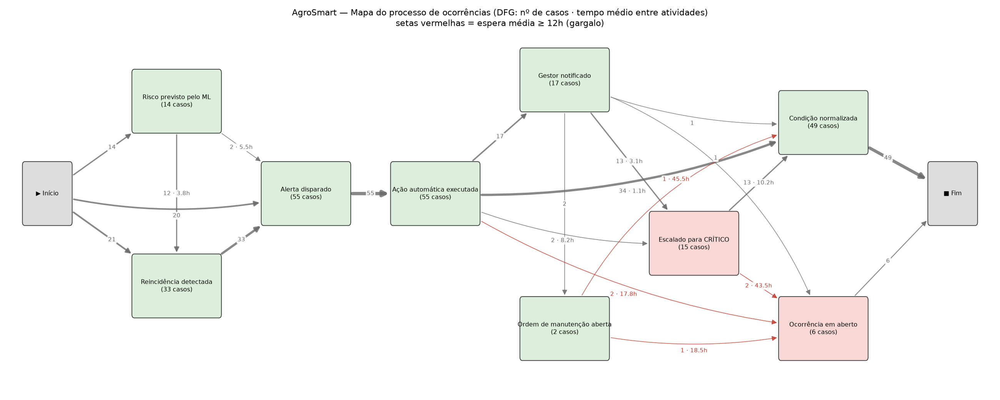
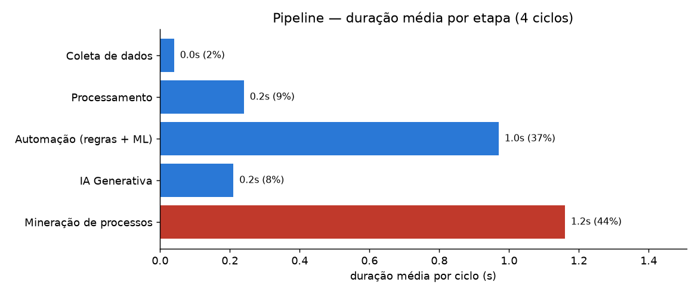

# 5. Análise de processo e demonstração final (25%)

Usamos **mineração de processos** para olhar a plataforma por dois ângulos:

- **Processo operacional** — o que acontece no campo desde que um problema aparece até ele ser resolvido
  (o processo que o produtor vive).
- **Processo técnico** — como o pipeline executa cada ciclo (o processo que a equipe de TI opera).

Tudo é gerado automaticamente a cada ciclo por `mineracao/mineracao_processos.py`, a partir das saídas reais da
plataforma. Resultados abaixo: semente 42, 7 dias, 6 talhões.

## 5.1 Fluxo de execução ponta a ponta

```
ENTRADA                    PROCESSAMENTO                  AUTOMAÇÃO / DECISÃO                         SAÍDA
sensores IoT (30 min) ──► limpeza · validação · ──► regras ─► episódio ─► ação automática ──► alertas · log de ações
Arduino (serial)          features (trusted)        ML ─► risco 6h ─┘    └► decisão combinada ──► dashboard · relatório IA
                                                                                               └► event log ─► mineração
```

## 5.2 Event log

Cada **caso** é uma ocorrência: um episódio de alerta de uma regra em um talhão (`talhão | regra | início`).
As atividades vêm de dados reais da plataforma:

| Atividade | Origem do evento | Recurso |
|---|---|---|
| Risco previsto pelo ML | `predicoes_risco.csv`: risco ALTO até 6h antes do alerta | Modelo ML |
| Reincidência detectada | `alertas.csv`: mesma regra no mesmo talhão em menos de 24h | Motor de regras |
| Alerta disparado | `alertas.csv`: início do episódio | Motor de regras |
| Ação automática executada | `alertas.csv`: ação da regra (`IRRIGACAO_ON`, câmera, etc.) | Automação |
| Gestor notificado | regras que notificam (falha de irrigação, temperatura, infestação) | Automação |
| Ordem de manutenção aberta | regra FALHA_IRRIGACAO | Equipe de manutenção |
| Escalado para CRÍTICO | leituras: o nível piorou durante o episódio | Motor de regras |
| Condição normalizada | leituras: 1ª leitura em que a regra deixou de disparar | Sensor de campo |
| Ocorrência em aberto | episódio ainda ativo no fim da janela | Gestor |

**Exemplo real** — as duas falhas de irrigação do TAL-02 (a 1ª levou 45,5h para normalizar; a 2ª foi prevista pelo ML 6h antes e terminou em aberto) e um déficit hídrico resolvido pela irrigação automática no TAL-01 (`evidencias/processo/event_log.csv` — formato padrão `case_id, atividade, timestamp, recurso`):

```csv
case_id,atividade,timestamp,recurso,talhao_id,regra,nivel,detalhe
TAL-02|FALHA_IRRIGACAO|20261001-060000,Alerta disparado,2026-10-01 06:00:00,Motor de regras,TAL-02,FALHA_IRRIGACAO,CRITICO,Solo seco (<30%) e irrigação não acionou
TAL-02|FALHA_IRRIGACAO|20261001-060000,Ação automática executada,2026-10-01 06:00:00,Automação,TAL-02,FALHA_IRRIGACAO,CRITICO,Ordem de manutenção aberta para o sistema de irrigação; gestor notificado
TAL-02|FALHA_IRRIGACAO|20261001-060000,Gestor notificado,2026-10-01 06:00:00,Automação,TAL-02,FALHA_IRRIGACAO,CRITICO,
TAL-02|FALHA_IRRIGACAO|20261001-060000,Ordem de manutenção aberta,2026-10-01 06:00:00,Equipe de manutenção,TAL-02,FALHA_IRRIGACAO,CRITICO,
TAL-02|FALHA_IRRIGACAO|20261001-060000,Condição normalizada,2026-10-03 03:30:00,Sensor de campo,TAL-02,FALHA_IRRIGACAO,CRITICO,
TAL-02|FALHA_IRRIGACAO|20261004-050000,Risco previsto pelo ML,2026-10-03 23:00:00,Modelo ML,TAL-02,FALHA_IRRIGACAO,CRITICO,probabilidade 85%
TAL-02|FALHA_IRRIGACAO|20261004-050000,Alerta disparado,2026-10-04 05:00:00,Motor de regras,TAL-02,FALHA_IRRIGACAO,CRITICO,Solo seco (<30%) e irrigação não acionou
TAL-02|FALHA_IRRIGACAO|20261004-050000,Ação automática executada,2026-10-04 05:00:00,Automação,TAL-02,FALHA_IRRIGACAO,CRITICO,Ordem de manutenção aberta para o sistema de irrigação; gestor notificado
TAL-02|FALHA_IRRIGACAO|20261004-050000,Gestor notificado,2026-10-04 05:00:00,Automação,TAL-02,FALHA_IRRIGACAO,CRITICO,
TAL-02|FALHA_IRRIGACAO|20261004-050000,Ordem de manutenção aberta,2026-10-04 05:00:00,Equipe de manutenção,TAL-02,FALHA_IRRIGACAO,CRITICO,
TAL-02|FALHA_IRRIGACAO|20261004-050000,Ocorrência em aberto,2026-10-04 23:30:00,Gestor,TAL-02,FALHA_IRRIGACAO,CRITICO,ainda ativa no fim da janela analisada
TAL-01|DEFICIT_HIDRICO|20260929-123000,Alerta disparado,2026-09-29 12:30:00,Motor de regras,TAL-01,DEFICIT_HIDRICO,AVISO,Umidade do solo baixa ou caindo rápido sem chuva
TAL-01|DEFICIT_HIDRICO|20260929-123000,Ação automática executada,2026-09-29 12:30:00,Automação,TAL-01,DEFICIT_HIDRICO,AVISO,Comando IRRIGACAO_ON enviado ao controlador do talhão (ciclo de 30 min)
TAL-01|DEFICIT_HIDRICO|20260929-123000,Condição normalizada,2026-09-29 15:00:00,Sensor de campo,TAL-01,DEFICIT_HIDRICO,AVISO,
```

O mesmo log sai em **XES** (`event_log.xes`, padrão IEEE 1849) para abrir no ProM, Disco, Celonis ou pm4py.
O processo técnico tem o seu log em `event_log_pipeline.csv` (case = ciclo, atividade = etapa, início/fim medidos).

Tamanho: **55 casos, 246 eventos, 9 atividades, 16 variantes.**

## 5.3 Representação do processo

Mapa do processo descoberto (Directly-Follows Graph). Espessura = nº de casos; rótulo = casos · tempo médio até a
próxima atividade; **vermelho = espera média ≥ 12h**.



Processo técnico (duração média por etapa do ciclo):



O mesmo mapa aparece interativo na aba **🔀 Processo (mineração)** do dashboard.

## 5.4 Variantes

| # | Variante | Casos | % | Regras |
|---|---|---|---|---|
| 1 | Reincidência → Alerta → Ação → Normalizada | 18 | 32,7% | MOVIMENTO_NOTURNO |
| 2 | Alerta → Ação → Normalizada *(caminho feliz)* | 14 | 25,5% | DEFICIT_HIDRICO, MOVIMENTO_NOTURNO |
| 3 | Risco ML → Reincidência → Alerta → Ação → Gestor → Escalado p/ CRÍTICO → Normalizada | 7 | 12,7% | TEMPERATURA_EXTREMA |
| 4 | Alerta → Ação → Escalado p/ CRÍTICO → Normalizada | 2 | 3,6% | DEFICIT_HIDRICO |
| 5 | Risco ML → Reincidência → Alerta → Ação → Normalizada | 2 | 3,6% | DEFICIT_HIDRICO |
| … | mais 11 variantes (cauda longa) | 12 | 21,8% | — |

As 3 variantes principais cobrem **70,9%** dos casos; as outras 13 variantes são as exceções, e é nelas que
estão os problemas.

## 5.5 Desempenho por regra

| Regra | Casos | Críticos | Em aberto | Tempo até normalizar (média · mediana · máx) | Reincidência | Escalados | Antecipados pelo ML |
|---|---|---|---|---|---|---|---|
| MOVIMENTO_NOTURNO | 29 | 0 | 3,4% | 0,6h · 0,5h · 1,5h | **65,5%** | 0% | — |
| TEMPERATURA_EXTREMA | 14 | 12 | 14,3% | 9,9h · 9,5h · 14h | **78,6%** | **85,7%** | 71,4% (3,8h antes) |
| DEFICIT_HIDRICO | 9 | 3 | 11,1% | 8,4h · **3,2h** · **47h** | 33,3% | 22,2% | 33,3% (4,2h antes) |
| FALHA_IRRIGACAO | 2 | 2 | **50%** | **45,5h** | 0% | 0% | 50% (6h antes) |
| INFESTACAO | 1 | 1 | **100%** | nunca normalizou | 0% | 100% | 0% |

## 5.6 Análise: gargalos, variações e oportunidades de melhoria

### Gargalos

| # | Gargalo | Evidência | Causa |
|---|---|---|---|
| G1 | **Escalado para CRÍTICO → Condição normalizada** | 13 casos, **10,2h** de espera média, **132h acumuladas** — a maior espera do processo | Temperatura extrema: a ação automática só "aumenta a frequência de leitura e avisa"; nada atua sobre a causa, então a ocorrência espera o clima mudar |
| G2 | **Ordem de manutenção → Normalizada** | **45,5h** para normalizar; **50%** das falhas de irrigação ainda em aberto | Depende de pessoa: a ordem é aberta, mas o processo não tem SLA nem evento de "manutenção concluída" — ninguém sabe se alguém foi a campo |
| G3 | **Infestação nunca fecha** | 1 caso, escalado e **100% em aberto** há dias | Não existe atividade de "tratamento aplicado"; o caso só fecharia se as folhas doentes caíssem sozinhas |
| G4 | **Etapa "Mineração de processos" no ciclo técnico** | 44% do tempo do ciclo (1,2s); no 1º ciclo levou **9,9s** | Montar o cache de fontes do matplotlib na 1ª execução (*cold start*) e redesenhar o mapa a cada ciclo |
| G5 | **Etapa "Automação"** | 37% do ciclo | O Random Forest é **re-treinado a cada ciclo**, mesmo sem dados novos que justifiquem |

### Variações

| # | Variação | O que revela |
|---|---|---|
| V1 | DEFICIT_HIDRICO: mediana **3,2h**, máximo **47h** | Mesma regra com dois comportamentos: quando a bomba funciona, o `IRRIGACAO_ON` resolve em ~3h; quando a bomba está quebrada (TAL-02), o comando não tem efeito e o caso arrasta. O processo não verifica se a ação funcionou |
| V2 | Com ou sem "Risco previsto pelo ML" antes do alerta | **61,1%** das ocorrências críticas foram previstas, com **4,7h** de antecedência média — mas o processo **segue igual** nos dois casos: a previsão não dispara nenhuma ação |
| V3 | Reincidência | MOVIMENTO_NOTURNO (65,5%) e TEMPERATURA_EXTREMA (78,6%) se repetem quase toda noite; cada noite vira um caso novo |
| V4 | Ocorrências por talhão | TAL-04 concentra 20 das 55 (36%) — infestação + movimento noturno da lagarta |
| V5 | Escalonamento | 85,7% dos casos de temperatura começam em ATENÇÃO/AVISO e pioram para CRÍTICO: a ação inicial não segura a evolução |

### Oportunidades de melhoria

| # | Melhoria | Ataca | Impacto esperado |
|---|---|---|---|
| M1 | **Ação preventiva disparada pelo ML**: risco ALTO → irrigação preventiva / proteção contra geada antes do alerta | V2, G1 | Antecipar 61% das ocorrências críticas em ~4,7h; menos casos escalados |
| M2 | **Verificação do efeito da ação**: se a umidade não subir em 1h após `IRRIGACAO_ON`, abrir automaticamente FALHA_IRRIGACAO | V1, G2 | Detectar a bomba quebrada em ~1h, não em dias |
| M3 | **SLA e retorno da manutenção**: ordem com prazo (ex.: 8h), escalonamento se vencer e evento "manutenção concluída" pelo app | G2 | Reduzir 45h → < 8h; fechar o ciclo de rastreabilidade |
| M4 | **Atividade "tratamento aplicado"** na infestação (registro pelo agrônomo, foto da câmera para confirmar) | G3 | Fechar casos de praga e medir a eficácia do tratamento |
| M5 | **Supressão de alertas repetidos**: agrupar reincidências em < 24h e só notificar MOVIMENTO_NOTURNO se a câmera confirmar animal/praga | V3 | ~53% dos casos são movimento noturno sem gravidade → menos fadiga de alerta |
| M6 | **Proteção programada** para padrões recorrentes (geada toda madrugada no TAL-05) | V3, G1 | Ação agendada em vez de reação noturna |
| M7 | **Desempenho do pipeline**: re-treinar o modelo 1×/dia ou quando o F1 cair; pré-aquecer o cache do matplotlib na imagem (**já aplicado** no `Dockerfile`) | G4, G5 | Ciclo ~40% mais rápido; elimina o *cold start* de 9,9s |

### Processo ideal (to-be)

```
Risco ML ALTO ─► Ação preventiva ─► (sem alerta: evitado)
                       └─► Alerta ─► Ação automática ─► Verificação do efeito (1h) ─┬─► Normalizada
                                                                                   └─► Ordem com SLA ─► Manutenção concluída ─► Normalizada
```

## 5.7 Demonstração final e vídeo (5 a 8 min)

Roteiro do vídeo final em [`06_pitch_e_roteiros.md`](06_pitch_e_roteiros.md#roteiro-do-vídeo-final-5-a-8-min).
Link em `docs/link_video_fase7.txt`.

## 5.8 Como reproduzir

```bash
python run_plataforma.py                       # gera tudo, inclusive refined/processo/
python mineracao/mineracao_processos.py        # só a mineração (lê o que já foi gerado)
```

Saídas em `dados/refined/processo/` (cópia em `docs/fase7/evidencias/processo/`): `event_log.csv`, `event_log.xes`,
`event_log_pipeline.csv`, `variantes.csv`, `dfg.csv`, `desempenho_regras.csv`, `etapas_pipeline.csv`,
`dfg_operacional.png`, `etapas_pipeline.png`, `analise_processo.md` e `.json`.
